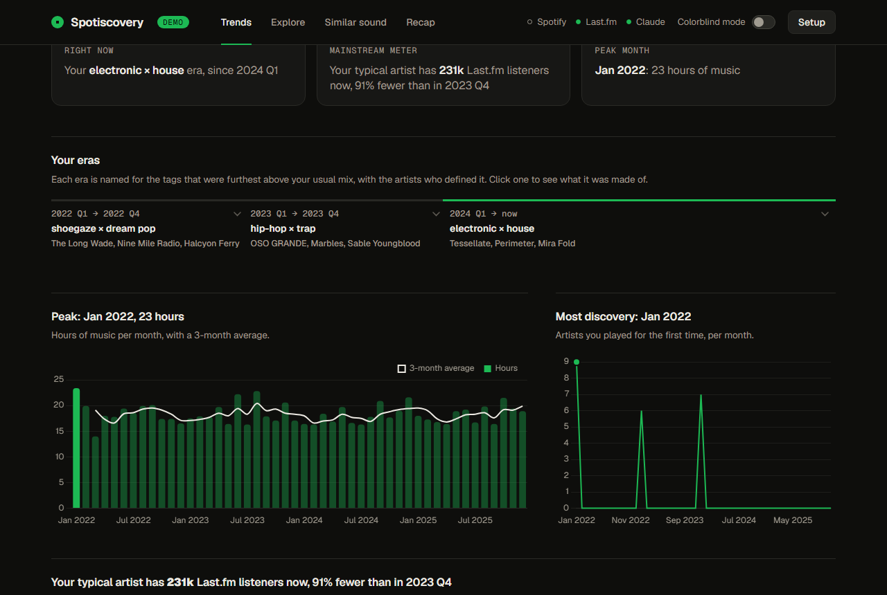
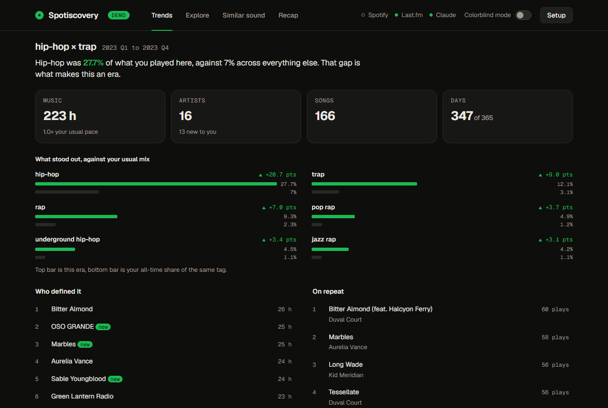
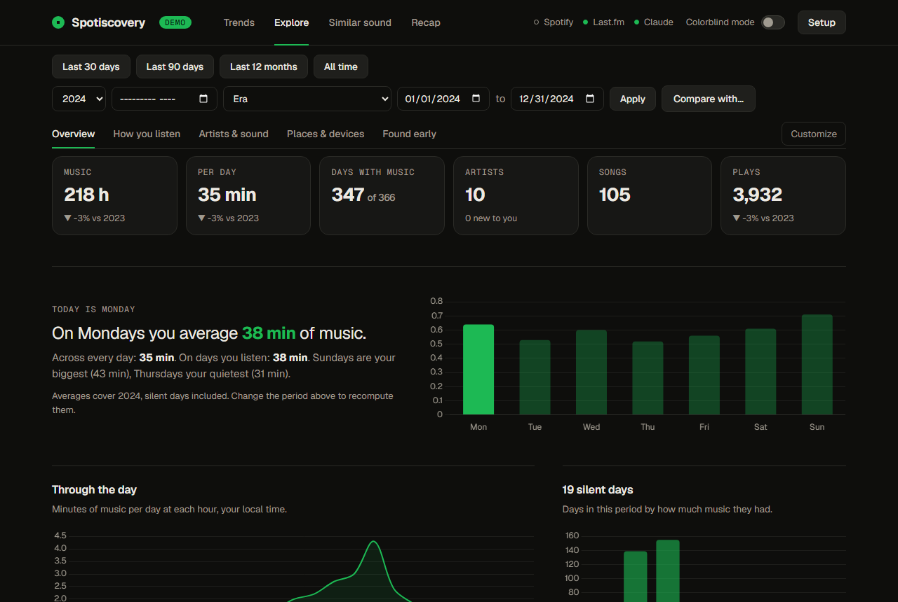
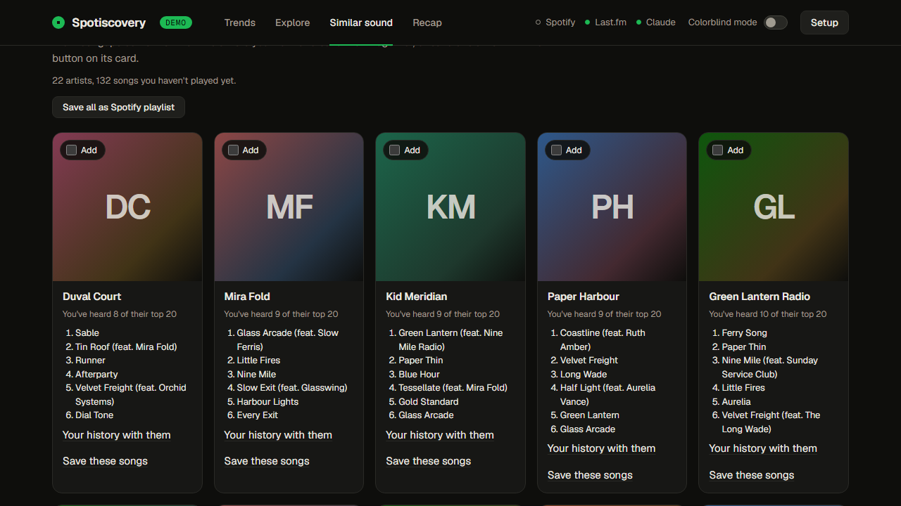
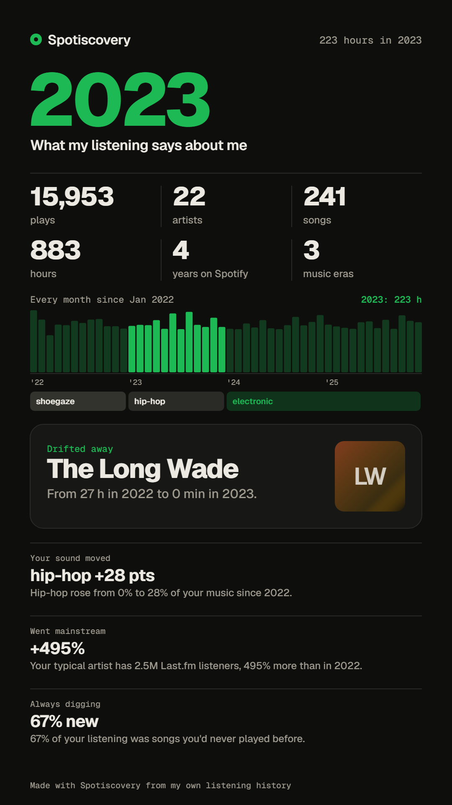

# Spotiscovery

Spotify tells you what you played. Spotiscovery tells you what it **means**, and finds the artists you
overlooked along the way.

It reads your Spotify listening history, splits it into the eras your taste actually moved through, and
recommends bands close to what you play now that you have never played. Everything runs on your own machine
against your own data.



## Try it in 30 seconds, no keys, no sign-up

```bash
pip install -r requirements.txt && python app.py
```

Open **http://127.0.0.1:8888** and click **Show me, with demo data**.

You get the entire app running on a generated four-year listening history: no API keys, no account, and no
network calls at all (the demo ships its own cached Last.fm and MusicBrainz answers, and a test fails the build
if anything tries to phone out). It lives in a separate database file, and while it is on, anything that would
touch a real account is refused.

The demo exists because the data that makes this good takes about five days to arrive from Spotify. You should
get to see the thing before you wait for it.

*Every screenshot on this page is the demo. None of it is a real person's listening.*

## What it does

**Eras, and why each one is an era.** Your history is split into stretches named for the genres that ran
furthest above your all-time mix. Click one and it opens in place, leading with the comparison that defines it.



**Any period, against the period before it.** Pick a year, a month, an era, or any two dates. Daily averages, a
calendar heatmap, top artists and songs with rank changes, streaks, sessions, binges, devices, countries, and
what you play at 3am. Click any artist, song or day to drill in. Put two periods side by side to see what
stayed and what left.



**Songs you have missed, and artists near your favourites.** The best-known songs by artists you already love
that are not in your history, plus a shelf of unplayed artists for each of your top artists. Tick what you want
and save it straight to a private Spotify playlist.



**A recap card that summarises you, not a top-five list.** Spotiscovery scores about twenty kinds of finding
(a song you came back to after seven years, an artist you drifted from, a band you caught before they blew up,
where your taste moved) and leads with the most unusual. Pick which ones make the card, then download it.



Also in here: a mainstream meter that tracks the listener count of your typical artist over time, lost loves
you quietly stopped playing, a travel map of where you listened, albums you play front to back versus
cherry-pick, and an optional **Ask Claude** mode that proposes sound directions with every artist it names
verified against Last.fm first, so it cannot invent a band.

Artists you already know are never recommended, including Last.fm's misspelled duplicates ("Travi$ Scott"),
collabs with artists you play, and side projects. Podcasts, audiobooks and sleep sounds are detected and kept
out of every chart.

> **Why Last.fm?** In November 2024 Spotify shut off its recommendations, related-artists and audio-features
> APIs for new apps. Spotiscovery gets your *history* from Spotify and *similarity and genre tags* from
> Last.fm, which is free.

## Setup with your own data

You need Python 3.10+. Four steps, and the app numbers them for you. Only the first is required:

| Step | What | How long |
|---|---|---|
| 1 | **Last.fm API key**: every recommendation and genre comes from here | 1 minute, free |
| 2 | **Your history**: connect Spotify for the last 30 days, or upload the export for everything | instant, or about 5 days for the export |
| 3 | **Spotify Client ID**: only if you want to connect Spotify or save playlists | 5 minutes |
| 4 | **Anthropic API key**: only for Ask Claude | optional |

The one worth waiting for is the export. Trends, Explore and Recap are built on years of plays, and connecting
Spotify alone gives you the last 30 days.

```bash
git clone https://github.com/jengstrom501/spotiscovery.git
cd spotiscovery
pip install -r requirements.txt
python app.py
```

Open **http://127.0.0.1:8888**. The **Setup** panel opens on first run: paste your keys there and click **Save
keys**. No file editing needed. (Prefer the file? Run `cp .env.example .env` and fill it in by hand. Both write
the same `.env`, and Setup shows a saved key as already set.)

### 1. Last.fm API key

Create one at [last.fm/api/account/create](https://www.last.fm/api/account/create). It takes a minute and you
can leave the callback URL blank. Paste it into the Setup panel (or `.env` as `LASTFM_API_KEY`).

### 2. Your full history (optional, strongly recommended)

The Spotify API only shows your top artists and your last 50 plays. For real trends, go to your
[Spotify privacy page](https://www.spotify.com/account/privacy/) and request either export:

- **Account data**: your last year of plays, usually within 5 days.
- **Extended streaming history**: your whole history with more detail, up to 30 days.

Upload the zip Spotify sends you directly, no unzipping needed. Plays under 30 seconds are ignored.

The extended history also carries albums, devices, countries, shuffle and how each song started, which Explore
uses. If you imported before Spotiscovery stored those, upload the same zip again: existing plays get the extra
fields and nothing is duplicated. (Your IP address, also in the export, is never stored.)

### 3. Spotify Client ID (only for connecting Spotify or saving playlists)

1. Open [developer.spotify.com/dashboard](https://developer.spotify.com/dashboard) and choose **Create app**.
2. Enter any name and description. Set **Redirect URI** to exactly `http://127.0.0.1:8888/callback`. Spotify
   doesn't accept `localhost`.
3. Under "Which API/SDKs", tick **Web API**, then save.
4. Copy the **Client ID** into the Setup panel (or `.env` as `SPOTIFY_CLIENT_ID`). No client secret needed.

The app runs in Spotify's development mode, which is fine for personal use. Spotify may require the account
that owns the app to have Premium. If someone else wants to use *your* app, add them under **User Management**.
Otherwise they can create their own.

### 4. Claude (optional)

Paste an Anthropic API key into the Setup panel (or `.env` as `ANTHROPIC_API_KEY`) to turn on **Ask Claude**.
One click costs a few cents. To use a different model, set `CLAUDE_MODEL` in `.env`.

### What to expect on the first run

Trends takes a minute or two and Similar sound takes two to four, because Last.fm allows about 5 requests per
second and Spotiscovery reads your top 300 artists plus everyone they point to. A progress bar counts it down.
Responses are cached for 30 days, so every run after that is seconds. Pushing the slider toward *Deep cuts*
looks further down the list, so it takes longer on a cold cache.

Release dates for "found them early" come from MusicBrainz, which allows one request per second, so the first
recap checks a few artists and finishes the rest in the background.

The default look is Spotify green. **Colorblind mode** (a switch in the header, remembered in your browser)
swaps it for blue with orange for errors, a pair that stays distinct with red/green color blindness. In both
modes nothing relies on color alone: changes carry arrows and signs, and the time-of-day chart uses a
single-hue ramp.

## How it works

| File | What it does |
|---|---|
| `app.py` | Flask routes, Spotify login callback, export upload |
| `spotify.py` | PKCE login, then top artists, recent plays, follows, saved-track artists |
| `lastfm.py` | Cached Last.fm client: similar artists, tags, listener counts, tag charts |
| `analyze.py` | Trends, taste drift, eras, the recap card's numbers |
| `explore.py` | Any-period analytics, artist pages, day play-by-play |
| `recommend.py` | The scoring (below) |
| `backtest.py` | Measures the recommendations against your own history (below) |
| `demo.py` | Generates the demo history and the cached API answers that go with it |
| `claude_mode.py` | Optional Claude directions, each artist verified against Last.fm |
| `static/index.html` | The whole UI, no build step |

**Scoring.** Each artist you play gets a weight from their minutes, with every play decayed by its age
(half-life 180 days) and artists you started in the last year counting double, plus a bonus if they are in your
Spotify top artists. For your top 300 artists, Spotiscovery collects Last.fm's similar artists. A candidate's
score is the sum of *(your weight for the seed × how similar the candidate is to it)*, times
`1 + ln(number of your artists pointing to it)`. Anyone you have played, follow, saved or rated is dropped;
*More like this* adds an artist as a seed. The obscurity slider divides the score by
`(1 + listeners/100k) ^ obscurity`, and no scene gets more than a quarter of the 40 picks.

How deep it looks is tied to that slider, because every candidate costs a Last.fm lookup and only the obscurity
penalty lifts a low-ranked candidate into the results. Measured on real history, the final 40 came from raw
ranks 0-41 at obscurity 0, 0-157 at 0.5 and 0-277 at 1, so the pool scales from 60 to 300 to match. That is
80% fewer API calls at the mainstream end for identical output.

**Backtest.** `python backtest.py` hides a year of your history, recommends from only what came before it, and
checks where the artists you went on to adopt (30+ minutes, new to you) land. It does this for each of your
last three years.

On the author's history, moving from all-time minutes and 50 seeds to the current method took adopted artists
in the top 300 candidates from 4 to 11. The final top 40 held about one either way, which is too few to rank
methods on, so the denser number drove the decision. The lesson it produced: new finds hang off the long tail
of a scene you are getting into, not your all-time favourites, which is why the seeds go 300 deep and lean
recent.

**Songs you have missed.** For your top 40 artists, Last.fm's top 20 songs minus every song in your history
(versions like "Remastered" count as the same song). Artists with the most gaps come first.

**Sounds like your favourites.** For each of your top 10 artists, their Last.fm similar artists you do not
know, ranked by match with the obscurity penalty applied. An artist appears under one favourite only.

## Privacy and security

- **Your data stays on your machine.** The app listens on `127.0.0.1` only. Your history and Spotify tokens
  live in `deep_cuts.db`, your API keys in `.env`. Both are git-ignored. Treat them like passwords: the
  database holds a Spotify refresh token, so never commit, share or upload it.
- **What leaves your machine:** artist and song names go to Last.fm, MusicBrainz, Deezer and Spotify to look up
  similar artists, release dates and photos. Nothing is sent to Anthropic unless you click *Ask Claude*, which
  sends a summary of your top artists and tags using your own key. Spotify's `ip_addr` field is never stored.
- **Do not expose it to a network.** There is no login, so anything that can reach the port can read your
  history and use your keys. Do not bind it to `0.0.0.0`, port-forward it, or put it behind a tunnel.
- **Built in:** requests with a foreign `Host` (DNS rebinding) or a cross-site `Origin` on writes are refused;
  the page cannot be framed; a Content-Security-Policy limits where scripts and requests can go; third-party
  scripts are pinned to exact versions with integrity hashes; the photo relay only fetches from Spotify's and
  Deezer's image hosts and does not follow redirects; the Spotify bearer token is refused for any non-Spotify
  URL.
- **Screenshots:** if you share a screenshot or a recap card from your own data, it shows your real listening.

Found a security problem? Please open an issue, without personal data in it.

## Tests

```bash
python test_recommend.py && python test_regressions.py
```

Plain assert scripts, no framework. `test_regressions.py` carries one test per bug that has been found and
fixed, each naming the symptom it guards against.

## License

MIT
